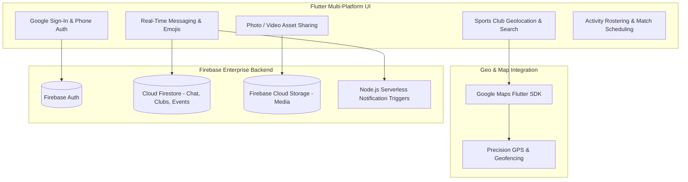

# 🏃‍♂️ Sprint Index — Athletic Community & Sports Discovery Network

> **Cross-Platform Athletic Community & Sports Club Discovery Platform** built with **Flutter & Dart**, featuring real-time group chat, interactive Google Maps club geolocation, Firebase Cloud Functions push notifications, and activity coordination.

[](https://flutter.dev)
[](https://dart.dev)
[](https://firebase.google.com)
[](https://developers.google.com/maps)
[](https://sprintindex.wordpress.com/)

---

## 📌 Executive Summary

**Sprint Index** is a mobile community platform designed to connect sports enthusiasts, athletes, and local athletic clubs. Built with Flutter, it empowers users to discover nearby sports clubs, coordinate training sessions, share live GPS locations of sporting venues, and engage in high-speed team chats with multimedia sharing.

**Live Project Showcase:** [sprintindex.wordpress.com](https://sprintindex.wordpress.com/)

---

## 🏗️ System Architecture



---

## ✨ Key Features & Capabilities

### 1. 🗺️ Interactive Club & Venue Discovery
- **Map Geolocation:** Search and browse sports facilities, football turfs, cricket grounds, and running tracks on an interactive map.
- **Club Information Sheets:** Rich bottom sheets displaying operating hours, membership tiers, address directions, and organizer contacts.

### 2. 💬 Real-Time Athletic Chat & Media
- Sub-second messaging backed by Cloud Firestore real-time snapshots.
- Inline media transmission supporting photos, training video clips, and rich emoji reactions.
- Custom notification triggers via Firebase Cloud Functions dispatching push alerts for incoming team messages.

### 3. 📅 Community Event Rostering
- Plan friendly matches, running club meetups, and open-court drills.
- Real-time RSVP counters and participant management.

---

## 💻 Tech Stack & Architecture

| Layer | Technologies |
| :--- | :--- |
| **Frontend Framework** | Flutter SDK 3.9+ (Cross-Platform Android, iOS, Web) |
| **Language** | Dart 3.x (Sound Null Safety) |
| **Backend & Realtime** | Firebase Authentication, Cloud Firestore, Firebase Storage |
| **Cloud Functions** | Node.js Serverless Push Notification Pipeline |
| **Mapping & Location** | `google_maps_flutter`, `geolocator`, `geocoding` |
| **Monetization** | Google Mobile Ads (`google_mobile_ads`) |

---

## 🚀 Getting Started

### Prerequisites
- [Flutter SDK](https://docs.flutter.dev/get-started/install) (`>= 3.9.0`)
- A Firebase project with Firestore and Cloud Storage enabled
- Google Maps Platform API key

### Setup Instructions
```bash
# Clone the repository
git clone https://github.com/itismemuhammadali/Sprint-Index.git
cd Sprint-Index

# Configure API Keys
cp api_keys_template.env api_keys.env

# Run on target device
flutter run -d chrome    # Web
flutter run -d android   # Android
flutter run -d ios       # iOS
```

---

## 👤 Author

- **Muhammad Ali**
  - **GitHub:** [@itismemuhammadali](https://github.com/itismemuhammadali)
  - **Showcase:** [Sprint Index Web](https://sprintindex.wordpress.com/)
